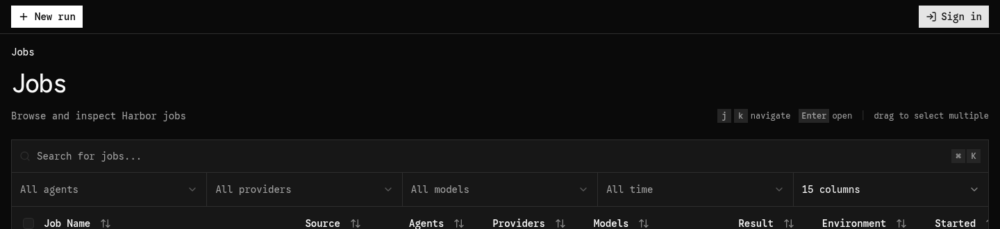
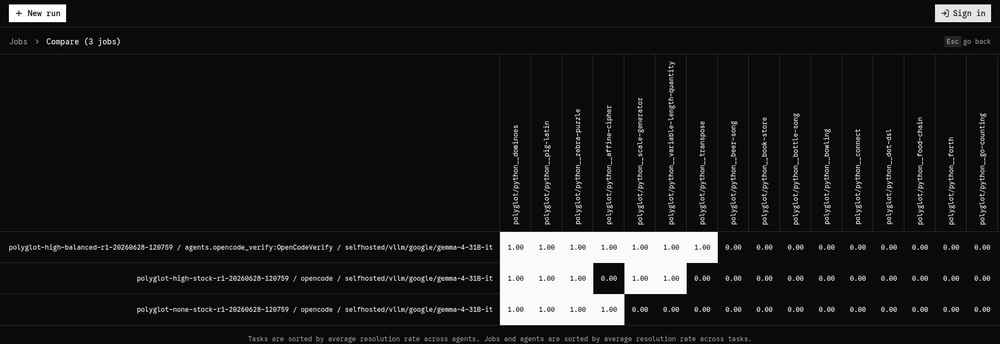
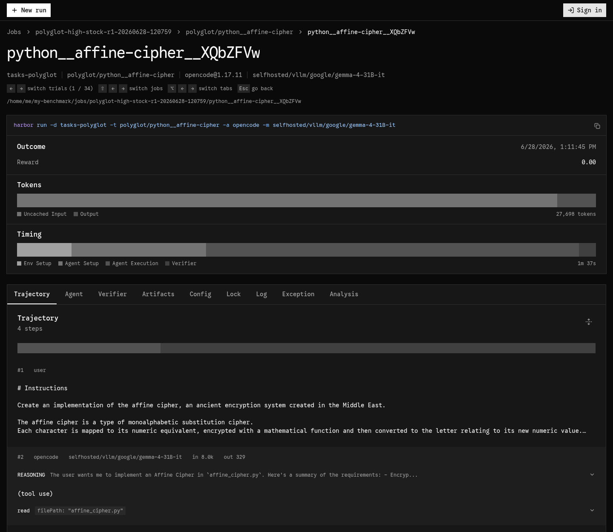
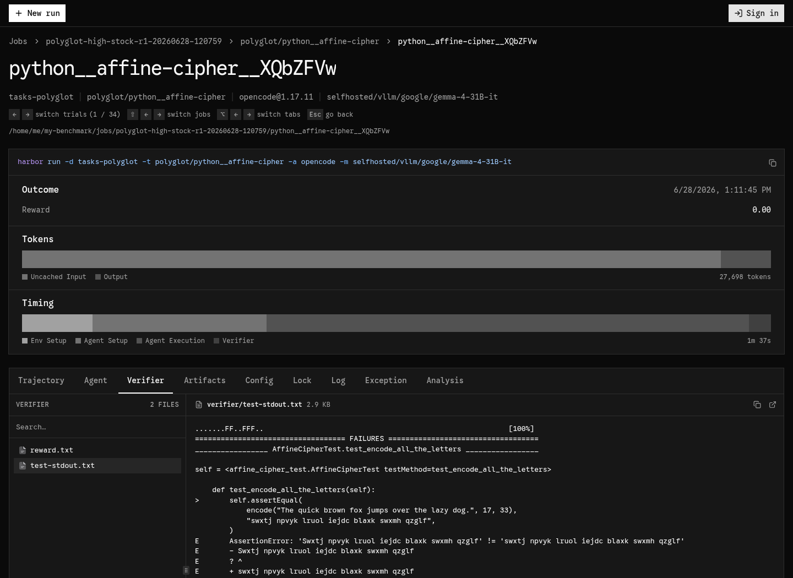

# Improving the harness for a model

A score belongs to *model x harness*. When a model scores low, the question is how much
of that is the model and how much is a harness that doesn't suit it. The only way to
find out is to read what the agent actually did. This page describes the loop I use,
the Harbor tools that help with it, and a worked example.

For the knobs themselves (agent loop, `AGENTS.md`, MCP, skills), see
[Tweak the harness and context](running-and-results.md#tweak-the-harness-and-context).

## The loop

1. Run a baseline. Use a stock agent with sensible settings for the model, and run
   it at least twice so you know how much it moves on its own.
2. Find the failures. Look at which tasks fail, and which ones flip between runs.
3. Read the trajectories. For each failure, check what the grader says went wrong
   and what the agent did. Did it explore, write, test, loop, or give up?
4. Attribute each failure. Every failure belongs to one of these:
   - *model*: it did the work properly and still got the logic wrong.
   - *harness*: something in the setup got in its way or failed to steer it. Examples:
     it never ran its code, it hunted for the hidden tests, its tool calls were dropped,
     it hit the timeout, or its output was truncated.
   - *task*: the instruction left out something the grader checks. Fix the task, not
     the harness (see [Writing tasks](writing-tasks.md)).
   - *infra*: the container, the endpoint or the verifier failed.
5. Change one thing. Target the harness failure that blocks the most tasks, and keep
   the change task-agnostic.
6. Re-run and compare against the baseline, task by task. Then go back to step 2.

Stop when the remaining failures are mostly *model*. What's left is that model's
score with a harness that suits it, and that's the number to compare across models.

## Find the failures

Start with the numbers per run:

```bash
python3 scripts/results.py jobs/gemma-stock-r1
```

```
   trials: 34   pass rate: 14.7%   mean tests passed: 45.1%
   per trial: 7.9 steps, 80,695 input tokens, 5,162 output tokens
```

Very few steps per trial, or an output-token count close to the model's limit, are
already a hint. If trials crashed, `results.py` also prints an infra-adjusted pass rate
that leaves out the crashes that weren't the agent's fault.

Then open the runs in Harbor's viewer:

```bash
harbor view jobs
```

The jobs page lists every run with its agent, model, mean reward, errors and token
counts. Select two or more runs and click Compare:



The compare page is a task x run matrix of rewards. Tasks are sorted by how often they
were solved, so the columns where one run is white and another black are the tasks
whose outcome changed. Click a cell to open that trial:



The same table in the terminal, with the tasks that differ marked:

```bash
python3 scripts/results.py jobs/gemma-stock-r1 jobs/gemma-rules-r1 --compare
```

```
   task                                        [0]    [1]
   python__affine-cipher                      fail   pass   <- differs
   python__beer-song                          fail   fail
   ...
   python__transpose                          fail   pass   <- differs

   2 of 34 tasks differ between runs. Open those trials in `harbor view`.
```

With `-k 3`, each cell shows passes out of attempts (e.g. `2/3`) instead.

## Read the trajectories

A trial page shows the outcome, a token and timing breakdown, and tabs for everything
Harbor recorded: the Trajectory (every step, with reasoning and tool calls), the
Verifier output, the Artifacts (the workspace as the agent left it), the
Config, the Log and the Exception. Use the arrow keys to move to the next
trial, and shift + arrow keys to see *the same task in the other runs*. That shortcut
is the quickest way to see what a harness change did to one task.



Start with the Verifier tab to see *what* was wrong. The pytest output shows which
requirement failed and why:



Then read the trajectory to see *why*. For a quick look in the terminal there's
`scripts/trajectory.py`, which prints one line per step:

```bash
python3 scripts/trajectory.py jobs/gemma-stock-r1 --task affine
```

Things to look for:

| What you see in the trajectory | Likely cause | What to try |
|---|---|---|
| Writes the code and finishes without ever running it | harness: nothing tells it to verify | a rules file: "run your code before you finish" |
| `find / -name '*test*'`, pytest collecting 0 items | harness: it's looking for the hidden grader | tell it there is no test suite and it must write its own checks |
| Tool-call syntax as plain text in the last message | serving: wrong tool-call parser or chat template | fix the vLLM/SGLang flags, not the prompt |
| The same edit or test run over and over until `AgentTimeoutError` | harness: unbounded loop | bound the loop ("at most 3 test runs"), or raise the timeout if it's just slow |
| Last turn has ~0 output tokens right after writing code | harness: output truncated | raise `max_tokens` |
| Renamed functions, changed error messages | model, or task if the instruction didn't specify them | rules: "keep the interface"; or fix the instruction |
| Thorough exploration and testing, still wrong | model | nothing; this is the signal you want to measure |

Read a couple of *passing* trials too. What they do differently is often the rule
you're looking for.

Harbor can also do a first pass for you. `harbor analyze jobs/<job>` runs an LLM
judge over the trajectories (by default it checks for reward hacking and for
underspecified tasks). It writes an `analysis.json` per trial, which the viewer shows in
the trial's Analysis tab. By default the judge is Claude Code with Haiku, so it
needs an `ANTHROPIC_API_KEY`; use `-a`/`-m` to pick a different agent and model.

## Let an agent do the first pass

Reading 30 trajectories per run takes a while. The repo includes a Claude Code skill,
[`analyze-trajectories`](../.claude/skills/analyze-trajectories/SKILL.md), that follows
the loop above. It runs `results.py` and `trajectory.py`, reads the verifier output
and the trajectories of the failing and flipped tasks, puts every failure in one of
the four buckets, and writes a report with ranked harness changes and the trial names
behind each one.

From Claude Code in this repo:

```
> analyze the trajectories of jobs/<run-id-1>, compared to jobs/<run-id-2>
```

Treat the report as a list of leads, not as the conclusion. Open the trials it cites in
`harbor view` and check them yourself before you change the harness.

## Rules of thumb

- Change one thing per run and give the run a descriptive `--job-name`, or you
  won't know what caused the change.
- Keep it task-agnostic. "Run your code before you finish" improves the harness.
  "Dates are day-first" leaks the grader into the prompt.
- Count before you fix. A signature that blocks 6 tasks is worth more than a clever
  fix for 1.
- What helps one model can hurt another. Strict rules that help a small model can
  make a frontier model slower or worse. Tune per model and keep the variants side by
  side.
- Fix task bugs when you find them. A task that fails because of its instruction
  biases every model, so fix it and re-run the affected jobs.